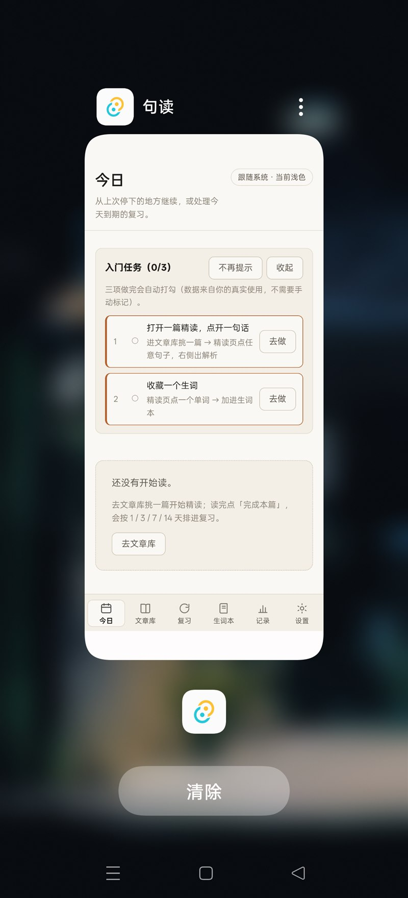
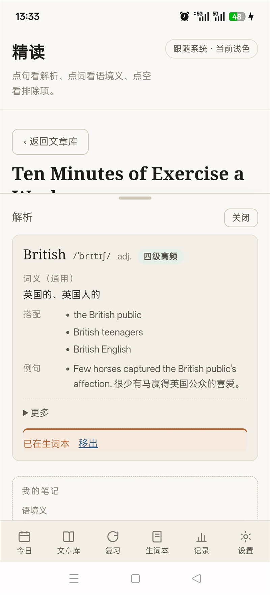
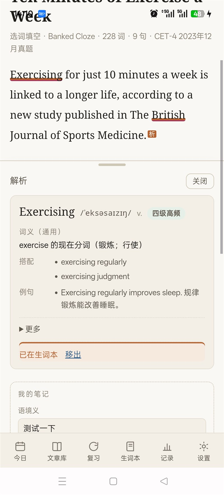

<div align="center">

# 句读 Judou

**CET4/CET6 阅读精读工具 · 桌面 + Android · 全程离线**

内置 **72 篇**历年真题，逐句拆解、点词看义、笔记生词、间隔复习

[](#下载安装)
[](#下载安装)
[](#设计取舍)
[](LICENSE)
[](02-代码/README.md)
[](02-代码/README.md)

</div>

---

## 这是什么

做英语精读的人都有这个困境：**遇到生词要么查了就忘，要么记下来却从不复习**。

市面上的背单词 App 把词从原文里剥出来，变成孤立的卡片；而真正的阅读理解需要的是「这个词**在这句话里**是什么意思」。

句读的做法是**反过来**：

- 读一篇真题 → 点任意句子，看到这句话的**结构拆解 + 直译 + 顺译**
- 点任意单词，看到它的**音标、词性、搭配、例句**
- 加入生词本时自动带上**语境义快照**（当时那句话的意思，内容更新也不回溯）
- 读完按 **1 / 3 / 7 / 14 天**自动排进复习队列

**全部离线**，没有账号、没有联网、没有广告。

---

## 界面

<table>
<tr>
<td width="50%"></td>
<td width="50%"></td>
</tr>
<tr>
<td align="center"><sub><b>文章库</b> — 72 篇按年份归档</sub></td>
<td align="center"><sub><b>精读页</b> — 句末「析」标记点开逐句解析</sub></td>
</tr>
<tr>
<td></td>
<td></td>
</tr>
<tr>
<td align="center"><sub><b>六段式解析</b> — 原句 / 翻译 / 主干 / 难点 / 考点 / 表达</sub></td>
<td align="center"><sub><b>词卡与正文标记</b> — 橙线=已收藏，蓝虚线=有笔记</sub></td>
</tr>
</table>

---

## 功能

### 精读

- **逐句六段式解析**：原句重述 / 直译 + 顺译 / 主干与成分划分 / 难点 / 考点 / 可迁移表达
- **点句即开**：句末「析」标记，触摸热区 44×44（真机验证过 5 点命中）
- **点词看义**：音标、词性、通用义、搭配、例句，CET4 高频标记

### 词汇

- **生词本**：收藏时自动存**语境义快照**，按词形归并（同词不同句只一条）
- **三档掌握度**：`new` / `fuzzy` / `known`，影响复习优先级
- **正文可见标记**：已收藏 = **橙色实线**，有笔记 = **蓝色虚线**，两者可共存 —— 不用点开就知道哪些词标记过

### 复习与记录

- **1 / 3 / 7 / 14 天**间隔复习队列，到期自动入列
- **阅读记录**：每题作答、正确率、阅读时长
- **统计页**：词汇增长、连续天数、正确率趋势

### 笔记

- **句子笔记**：写自己的理解，句子末尾「析」变实心红标
- **单词笔记**：语境义 / 记忆法，词下出现蓝虚线

### 其他

- **主题三档**：跟随系统 / 浅色 / 深色
- **窄屏适配**：手机端 6 Tab 底栏，含安全区（刘海屏、手势条）
- **导出**：生词表导出 PDF（**仅桌面**；Android 不支持打印通道，已明确禁用并说明）
- **备份恢复**：整库导出/导入

---

## 下载安装

前往 **[Releases](https://github.com/huanghaocheng30/Judou/releases)** 下载最新版本。

| 平台 | 文件 | 体积 | 说明 |
|---|---|---|---|
| **Windows 10/11** | `judou_0.2.1_x64-setup.exe` | 5.7 MB | NSIS 安装包，双击即装，**免 UAC**（`installMode=currentUser`） |
| **Android 8.0+** | `app-arm64-release.apk` | 34.6 MB | 仅 **arm64-v8a**（2017 年后主流机型）；装前需允许「安装未知来源应用」 |

**数据位置**
- Windows：`%APPDATA%\com.judou.app\judou.db` —— 卸载不删除，重装不丢
- Android：`/data/user/0/com.judou.app/` —— 卸载会清空

> 📌 Windows 安装包在 Release 页显示为 `judou_0.2.1_x64-setup.exe`（GitHub 会过滤附件名里的中文，故用 ASCII 名）。

**首启会导入 72 篇内置内容**（约 1.9 秒），之后不再重复。

> ⚠️ Windows 版与 debug 包签名不同，若装过开发版需先卸载；Android 同理。

---

## 已知限制

这些都是**内容侧**的边际缺失，不是功能缺陷：

| 编号 | 限制 | 影响面 |
|---|---|---|
| `D-M16-1` | 4 个选词填空的空格在正文中缺位 | 180 个空里的 4 个（2.2%），那几空无法在正文定位；题目/选项/解析仍完整 |
| `D-M16-2` | 新录入的 60 篇词卡只显示**通用义** | 词卡释义/音标/搭配/例句齐全，仅少「本文中意为…」一层（2023-12 那 12 篇有语境义） |
| `D-M16-3` | 个别词条质量参差 | 3,914 条里个别几条搭配/例句不够准 |
| `D-M11-1` | `article.visibility` 是历史字段（恒为 `system`） | 无用户可见影响 |
| — | 导出 PDF 仅桌面可用 | Android WebView 不支持打印通道，已改为禁用 + 说明 |

**平台支持**：仅 arm64-v8a（不支持 32 位 armv7 老机型与 x86 模拟器）；未上架应用商店。

---

## 设计取舍

| 决策 | 理由 |
|---|---|
| **不做用户导入** | 曾完整实现过（粘贴 / AI 解析两条通道，−12,704 行时移除）。实际问题：用户导入的内容没有预置解析，精读页会退化；维护两条内容管线成本远大于收益。改为**只做高质量内置内容** |
| **全程离线** | 无账号、无同步、无遥测。数据全在本地 SQLite，用户完全掌控 |
| **语境义快照** | 收藏时把当时的语境义写死在生词本里 —— 内容包升级不回溯，保证「你当时看到的意思」不变 |
| **不需要联网检查更新** | 避免为了一个「有新版本」提示引入网络栈 |

---

## 技术栈

| 层 | 选型 |
|---|---|
| 桌面外壳 | **Tauri v2**（Rust）—— Windows 安装包 5.7 MB，内存占用远低于 Electron |
| 移动 | Tauri v2 Android（同一套前端，`libjudou_lib.so` 内嵌内容包） |
| 前端 | React 18 + TypeScript + Vite 6（无 UI 库，纯手写 CSS） |
| 数据 | SQLite（`rusqlite` bundled）—— 迁移链 `001`→`003`，启动时自动升级 |
| 内容 | 73 个 JSON（20.9 MB），`include_dir` 编译期内嵌，首启解压到应用数据目录 |

**规模**：Rust ~6,500 行 · TS/TSX ~5,600 行 · 内置内容 72 篇 / 1,771 句 / 39,996 token / 540 题 / 3,914 词条

---

## 开发

**环境要求**：Rust stable、Node 18+、Windows 需 WebView2（Win11 自带）

```powershell
cd 02-代码
npm install
npm run tauri dev          # 开发模式
npm run tauri build        # 打 Windows 安装包
```

**质量门禁**（18 项，全部可复跑）

```powershell
npm run verify:invoke      # Tauri 命令注册与前端调用一致
npm run verify:sql         # 迁移链自洽（19 表 / 6 索引）
npm run verify:pack        # 内容包自洽（72/73 文件 SHA-256 / manifest 齐全）
npm run verify:render      # 渲染层守恒（39,996 token 零例外）
npm run verify:analysis    # 解析守恒（1,771/1,771）
npm run verify:contrast    # 对比度（38/38 达 AA）
npm run verify:records     # 记录层断言（39 条）
# ……以及 note / note-marks / vocab / review / release / pending / android / tables / icons / ci
cd src-tauri; cargo test   # 73 passed
```

**Android 构建**：见 [`00-项目管理/Android环境搭建.md`](00-项目管理/Android环境搭建.md) 与 `build-android-release.ps1`（**含三个会咬人的坑**：symlink 失败会清空 `.so`、不复制前端 assets、必须用 ASCII 路径构建）

---

## 项目结构

本项目按「六区协同开发规范 v2.1」组织，每个任务包都有完整的设计 → 开发 → 审查 → 验收留档：

```
00-项目管理/     规范、环境搭建、开发准备
01-设计/         需求、调研、方案、原型、任务包
02-代码/         源码（Rust + React + 内容包）
03-开发协同/     状态机、预算台账、决策记录、执行自测
04-测试/         验收结论、测试基线、全局回归
05-交付/         安装包、发布批次
内容生成模板/    内容生产工具与 60 篇源数据（verify:pack 的上游权威源）
90-历史归档/     已废弃方案
```

**19 个任务包**全部关账（M0 骨架 → M16 内容扩充，含 TP1 与 2 个修复包），设计基线 `DB-20261107-7`。

---

## 内容版权

- 内置篇目取自 **CET4 公开真题**，版权归原出处（全国大学英语四六级考试委员会）
- 解析、译文、词表为**学习用途的二次整理**
- 本项目**仅供个人学习**，不得用于商业用途
- 你创建的笔记与生词归你所有

## 许可

**代码**：[MIT](LICENSE) —— 可自由使用、修改、分发、商用，保留版权声明即可。

**内置内容**（CET4 真题原文、题目、答案）：版权归原出处所有，仅供个人学习研究，**不得商用**。详见 [LICENSE](LICENSE) 末尾的 Content Notice。

---

<div align="center">
<sub>用 Rust + React 手写的精读工具 · 数据全在你自己电脑里</sub>
</div>
