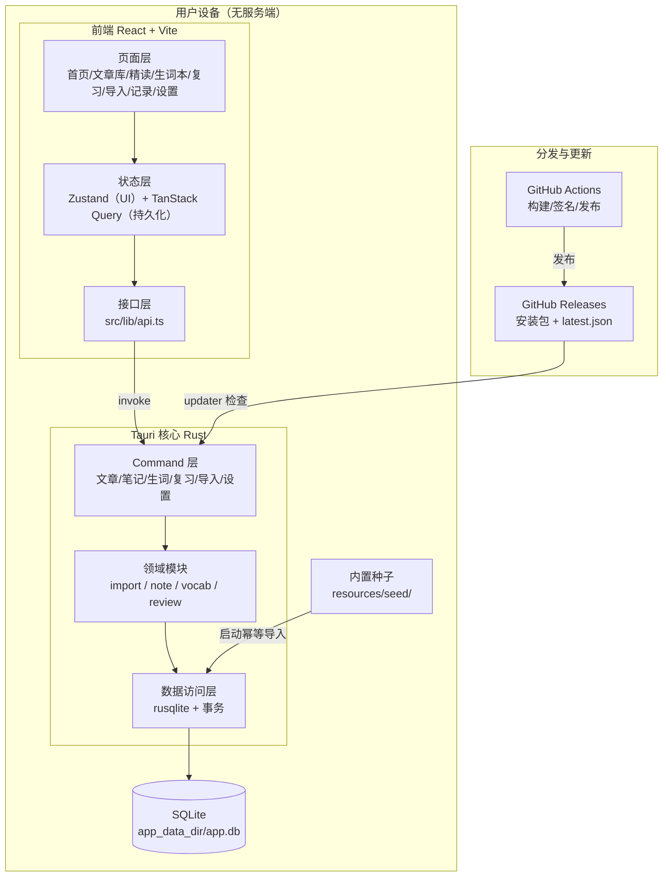
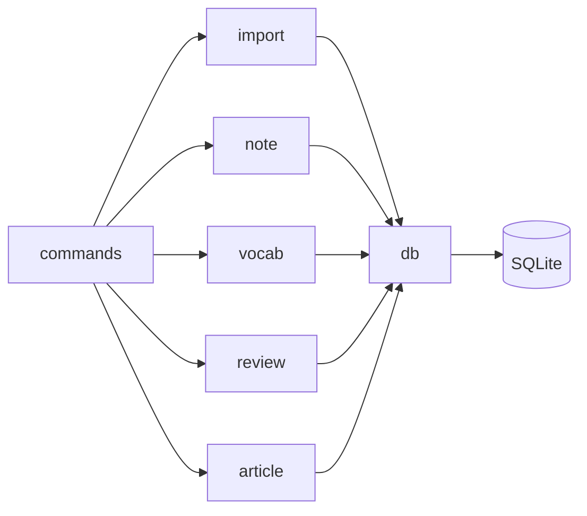

# C1 技术方案总览

> 版本：v1.0  
> 状态：定稿  
> 上游文档：`docs/A1-项目定义卡.md`、`docs/A2-PRD.md`  
> 下游文档：`docs/C2-数据模型设计.md`、`docs/C3-Command接口清单.md`、`docs/C4-导入模块设计规格.md`、`docs/C5-自动更新与发布方案.md`  
> 本文档定义技术栈、架构、模块划分、数据流、部署形态与关键约束。细节以各专项文档为准。

---

## 1. 文档说明

本文档回答三个问题：

1. **用什么技术做**：技术栈与选型理由。
2. **怎么组织**：分层、模块、目录结构。
3. **怎么跑起来、发出去**：数据流、构建、分发、更新。

不展开具体表结构、接口签名、切句算法——这些在 C2、C3、C4、C5 中定义。

---

## 2. 技术选型总表

| 层 | 选型 | 理由 | 不选什么 |
|---|---|---|---|
| 桌面容器 | **Tauri v2** | 安装包小、内存低、Rust 后端可直接操作 SQLite、GitHub 分发零成本 | Electron（包大、内存高） |
| 移动端 | **Tauri v2 Android** | 与桌面共用 Rust 核心和前端代码，一套代码两平台 | Flutter/RN（需另写一套，Vibe Coding 成本高） |
| 前端框架 | **React 18 + TypeScript 5** | AI 训练数据充分，生成质量高；TS 类型约束降低幻觉 | Vue（对 AI 生成友好度略低） |
| 构建工具 | **Vite** | 开发热更新快，Tauri 官方推荐 | Webpack（慢、配置重） |
| 状态管理 | **Zustand + TanStack Query** | Zustand 管全局 UI，TanStack Query 管持久化状态与缓存 | Redux（重）；useState 缓存数据库数据（禁止） |
| 后端语言 | **Rust** | Tauri 原生、性能好、SQLite 绑定成熟 | Node 侧车（多进程、多依赖） |
| 数据库 | **SQLite（rusqlite）** | 单文件本地库、零运维、事务可靠、跨平台 | IndexedDB（更新后可能重置）；服务端数据库（有成本） |
| 数据访问 | **rusqlite 手写 SQL** | 表结构简单，SQL 可控，无 ORM 抽象泄漏 | ORM/Query Builder（增加 AI 生成歧义） |
| 异步任务 | **Tauri 线程 + 同步 SQLite** | 单用户桌面场景，查询微秒级，无需任务队列 | 消息队列、后台服务 |
| 自动更新 | **Tauri updater + GitHub Releases** | 静态 `latest.json`、签名校验、零服务器 | 自建更新服务（有成本） |
| CI/CD | **GitHub Actions** | 公开仓库免费，`tauri-action` 成熟 | 自建 CI（有成本） |
| 分发 | **GitHub Releases** | 零成本、版本可追溯、可附校验和 | 应用商店（个人主体门槛高） |

### 2.1 一个明确的收敛：不用 Taro

小程序路线已放弃，**Taro 的核心价值（多端编译到小程序）不再需要**。MVP 直接使用 **React + Vite 独立项目**，由 Tauri 承载桌面和 Android。

- 好处：依赖更少、调试链路更短、AI 生成的代码更接近标准 React、无需处理 Taro 编译产物与 Tauri 的适配。
- 影响：`AGENTS.md` 中“由 Taro H5 产物或独立 React 项目承载”的表述，建议更新为“React + Vite 独立项目”。

---

## 3. 整体架构

### 3.1 架构图



### 3.2 文字说明

- **前端不直接访问数据库**。所有读写经 `api.ts` → `invoke` → Tauri command。
- **Rust 侧分三层**：Command（接口与参数校验）、Domain（业务逻辑，如切句、复习推进）、Db（SQL 与事务）。
- **SQLite 是唯一持久化介质**，单文件，位于系统应用数据目录。
- **内置文章**通过启动时的种子导入进入 SQLite，幂等，不覆盖用户笔记。
- **无服务端**。GitHub 只承担分发和更新清单，不存储用户数据。

---

## 4. 分层与模块划分

### 4.1 前端分层

| 层 | 职责 | 目录 |
|---|---|---|
| 页面层 | 路由、页面组合、布局 | `src/pages/` |
| 组件层 | 可复用 UI（句面板、词面板、文章卡片、复习条） | `src/components/` |
| 状态层 | 全局 UI 状态、服务端状态缓存 | `src/stores/`、`src/hooks/` |
| 接口层 | 封装所有 `invoke`，导出类型化 API | `src/lib/api.ts`、`src/lib/types.ts` |
| 工具层 | 格式化、常量、防抖、本地草稿 | `src/lib/utils/` |

**规则**：组件不出现 `invoke("...")` 字符串；持久化数据一律走 TanStack Query；本地草稿只用于保存失败兜底。

### 4.2 Rust 模块划分

| 模块 | 职责 | 目录 |
|---|---|---|
| command | Tauri command 注册、参数解析、错误转换 | `src-tauri/src/commands/` |
| import | 清洗、分段、切句、分词、commit 校验 | `src-tauri/src/import/` |
| note | 句笔记、词笔记的读写 | `src-tauri/src/note/` |
| vocab | 生词聚合、标签、导出 | `src-tauri/src/vocab/` |
| review | 复习计划生成、到期查询、推进 | `src-tauri/src/review/` |
| article | 文章查询、进度、删除 | `src-tauri/src/article/` |
| db | 连接管理、migration、种子导入 | `src-tauri/src/db/` |
| error | `CommandError` 定义与转换 | `src-tauri/src/error.rs` |

### 4.3 模块依赖方向



**约束**：`db` 不反向依赖业务模块；业务模块之间尽量不互相调用，共享逻辑下沉到 `db` 或独立工具模块。

---

## 5. 运行时数据流

### 5.1 精读读写

1. 页面进入 → `useQuery` 调 `get_article_content`。
2. Rust 查 article/paragraph/sentence/token/question，组装返回。
3. 用户点句子 → 前端调 `get_sentence_note`，有则回显。
4. 输入 → 防抖 → `upsert_sentence_note` → 事务写 `sentence_note`。
5. 保存成功 → TanStack Query 更新缓存；失败 → 本地草稿保留。

### 5.2 导入

1. 前端提交文本 → `parse_import_preview`（Rust 清洗/分段/切句/分词）→ 返回预览，不写库。
2. 用户确认 → `commit_import` → L1—L4 校验 → 事务写 article/paragraph/sentence/token。
3. 成功返回 `article_id` → 前端跳转精读页。

### 5.3 复习

1. 首页/复习页 → `get_due_reviews(date)` 查 `review_plan` 到期项。
2. 进入复习模式 → 复用精读页数据流，额外高亮笔记。
3. 点击完成 → `complete_review` → 事务写 `review_log` 并推进 `review_plan`。

### 5.4 更新检查

1. 应用启动（或手动检查）→ Tauri updater 请求 GitHub `latest.json`。
2. 版本较新 → 下载签名包 → 校验 → 安装（桌面端）。
3. Android 端不依赖 updater 插件，采用版本检查 + 引导下载 APK（见 C5）。

---

## 6. 项目目录结构

```text
project-root/
├── docs/                        # A1/A2/C1... 文档
├── src/                         # React 前端
│   ├── pages/
│   ├── components/
│   ├── stores/
│   ├── hooks/
│   ├── lib/
│   │   ├── api.ts               # 唯一 invoke 封装
│   │   ├── types.ts             # 与 Rust 返回结构对应
│   │   └── utils/
│   └── main.tsx
├── src-tauri/
│   ├── src/
│   │   ├── main.rs
│   │   ├── commands/            # 按领域分文件
│   │   ├── import/
│   │   ├── note/
│   │   ├── vocab/
│   │   ├── review/
│   │   ├── article/
│   │   ├── db/
│   │   └── error.rs
│   ├── migrations/
│   │   └── 001_init.sql
│   ├── resources/
│   │   └── seed/                # 内置文章 JSON
│   ├── capabilities/
│   │   └── default.json
│   ├── Cargo.toml
│   └── tauri.conf.json
├── .github/workflows/
│   └── publish.yml
├── AGENTS.md
├── README.md
├── LICENSE
└── package.json
```

**约定**：`src/lib/api.ts` 是前端访问后端的唯一出口；`migrations/` 只增不改；`resources/seed/` 与代码分离，便于替换内容。

---

## 7. 本地数据与存储

| 项 | 方案 |
|---|---|
| 数据库文件 | `app_data_dir()/app.db` |
| 连接管理 | `State<Mutex<Connection>>`，单连接 |
| 外键 | 启动执行 `PRAGMA foreign_keys = ON` |
| 迁移 | `migrations/00N_*.sql` + `schema_meta` 记录版本 |
| 种子导入 | 启动调用 `seed_system_articles_if_empty`，按 `source_key` 幂等 |
| 备份 | 设置页导出数据库文件（P1） |
| 敏感数据 | 无账号、无密钥、无用户身份信息 |

**不做**：云同步、多设备、账号体系、服务端备份。

---

## 8. 构建、打包与发布

### 8.1 构建目标

| 平台 | 产物 | 构建方式 |
|---|---|---|
| Windows | `.msi` / `.exe` | GitHub Actions `windows-latest` |
| macOS | `.dmg`（universal） | `macos-latest` + `--target universal-apple-darwin` |
| Linux | `.AppImage` / `.deb` | `ubuntu-22.04` |
| Android | `.apk` | Tauri v2 Android 构建，需 Android SDK/NDK |

### 8.2 发布链路

1. 修改 `tauri.conf.json` 版本号。
2. 推送 `v*` 标签。
3. GitHub Actions 矩阵构建、签名、创建 Release、上传安装包与 `latest.json`。
4. 用户从 Release 下载；桌面端由 updater 自动检查更新。
5. 详细配置见 `docs/C5-自动更新与发布方案.md`。

### 8.3 成本

| 项 | 成本 |
|---|---|
| 代码托管 | 0（公开仓库） |
| Actions 构建 | 0（公开仓库标准运行器免费） |
| 分发 | 0（GitHub Releases） |
| 自动更新 | 0（静态 JSON + Release 附件） |
| macOS 签名 | 可选，Apple Developer 年费；MVP 不做 |

---

## 9. 关键技术约束

以下约束是硬性的，写入 `AGENTS.md`，违反即返工。

1. **偏移量统一 UTF-16 code unit**。Rust 用 `encode_utf16().count()`，切片用 `utf16_slice` 辅助函数，禁止字节索引。
2. **前端不碰 SQL**，不拼 `invoke` 字符串，统一走 `api.ts`。
3. **写操作必须事务**，校验在事务外完成，`stmt` 在 `commit` 前 `drop`。
4. **commit 不重新切句分词**，只校验前端确认后的结构。
5. **表结构变更走新 migration**，不改已发布文件。
6. **系统文章禁止删除**，用户文章删除走 `ON DELETE CASCADE`。
7. **持久化状态走 TanStack Query**，不用 `useState` 缓存数据库数据。
8. **自动更新私钥必须备份**，丢失则已安装用户永久无法自动更新。
9. **Android 端更新机制与桌面不同**，不假设 updater 插件在 Android 上静默更新。
10. **不引入 ORM、连接池、NLP crate、服务端框架**，除非评估并记录理由。

---

## 10. 非功能性技术指标

| 指标 | 目标 |
|---|---|
| 冷启动时间 | 桌面 < 2s；Android < 3s |
| 精读页首屏 | 本地数据 < 1s |
| 句/词面板响应 | < 100ms |
| 笔记保存 | < 500ms（防抖后） |
| 安装包体积 | 桌面目标 < 20MB；Android 目标 < 30MB |
| 数据库单篇 token 量 | 千级以内，查询走索引 |
| 内存占用 | 空闲 < 150MB（桌面） |

---

## 11. 技术风险与应对

| 风险 | 影响 | 应对 |
|---|---|---|
| Tauri v2 Android 成熟度 | 构建或运行异常 | 早期在真机验证；保留纯前端 H5 本地包作为降级 |
| Android 无静默自动更新 | 用户需手动下载新 APK | 版本检查 + 引导下载；C5 中定义 |
| 跨平台 WebView 差异 | 点击/滚动/面板样式不一致 | Windows/macOS/Android 手动回归核心交互 |
| SQLite 并发写 | 多窗口或快速操作锁冲突 | 单连接 + Mutex；写操作短事务 |
| 自动更新签名密钥丢失 | 无法推送更新 | 私钥离线备份；首次发布前实际验证 |
| 内置文章升级导致笔记错位 | 用户笔记挂到错误句子 | `source_key` + `text_hash` 稳定识别；MVP 内置文章只增不改 |
| rusqlite 版本升级破坏兼容 | 构建失败 | 锁定版本；升级前跑全量测试 |

---

## 12. 与其它文档的关系

- **A1/A2**：定义做什么、做到什么程度；本文件不重复功能规则。
- **C2 数据模型设计**：本文件第 7 节的具体化。
- **C3 Command 接口清单**：本文件第 4.2 节接口层的具体化。
- **C4 导入模块设计规格**：本文件第 5.2 节导入数据流的详细规则。
- **C5 自动更新与发布方案**：本文件第 8 节的具体配置与验证步骤。
- **AGENTS.md**：本文件第 9 节约束的执行版本，AI 编码必须遵守。

---

*本文档随架构演进更新，技术选型变更需在 F3 决策记录中留痕。*
