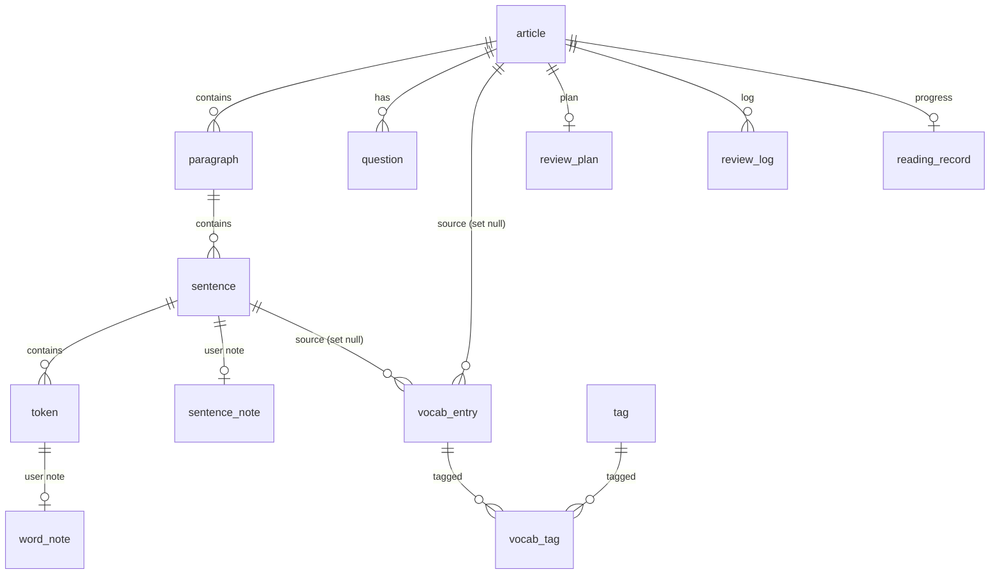

# C2 数据模型设计

> 版本：v1.0  
> 状态：定稿  
> 上游文档：`docs/A2-PRD.md`、`docs/C1-技术方案总览.md`  
> 下游文档：`docs/C3-Command接口清单.md`、`docs/C4-导入模块设计规格.md`  
> 本文档定义 SQLite 表结构、字段语义、索引、迁移策略与种子数据格式。字段命名、类型、约束以本文档为准。

---

## 1. 文档说明

### 1.1 目的

回答三个问题：

1. **存什么**：有哪些表、每张表存什么、字段含义。
2. **怎么连**：表之间的外键与级联规则。
3. **怎么演进**：迁移策略、种子数据格式、数据生命周期。

### 1.2 范围

覆盖 MVP 全部持久化数据。不包含前端本地草稿（`localStorage`）和服务端（无服务端）。

### 1.3 约束来源

- 偏移量统一 **UTF-16 code unit**，见 C1 第 9 节。
- 系统文章与用户文章分离，`visibility = 'system' | 'user'`，见 A1 第 7 节。
- 生词按 `normalized` 聚合，不做词形还原，见 A2 F3。
- 复习计划默认 1/3/7/14 天，见 A2 F4。

---

## 2. 设计原则

1. **单用户本地库**：MVP 不引入 `user` 表，所有数据属于本机用户。
2. **内容与用户数据分离**：`article / paragraph / sentence / token / question` 是内容结构；`sentence_note / word_note / vocab_entry / review_* / reading_record` 是用户数据。
3. **系统文章只增不改**：`visibility='system'` 的文章由种子导入，升级时按 `source_key` 幂等插入，不覆盖已有记录。
4. **外键级联清晰**：用户删除自己的文章时，关联的段落、句子、token、笔记、复习计划一并删除；生词保留但来源引用置空。
5. **偏移量可校验**：句子和 token 都存 `start_offset / end_offset`，commit 时做覆盖校验。
6. **索引服务于查询**：只为实际查询路径建索引，不预建“可能有用”的索引。
7. **迁移只增不改**：`001_init.sql` 发布后不再修改，结构变更新增 `00N_*.sql`。
8. **JSON 字段最小化**：只有 `question.options_json` 和 `app_setting.value` 使用 TEXT 存 JSON，其余结构化字段全部拆列。

---

## 3. 表清单与关系

### 3.1 表清单

| 分类 | 表 | 用途 | 数据归属 |
|---|---|---|---|
| 元信息 | `schema_meta` | 迁移版本记录 | 系统 |
| 内容 | `article` | 文章主表 | 系统/用户 |
| 内容 | `paragraph` | 段落 | 跟随文章 |
| 内容 | `sentence` | 句子 | 跟随文章 |
| 内容 | `token` | 词/标点 | 跟随句子 |
| 内容 | `question` | 题目 | 跟随文章 |
| 用户 | `sentence_note` | 句笔记 | 用户 |
| 用户 | `word_note` | 词笔记 | 用户 |
| 用户 | `vocab_entry` | 生词本条目 | 用户 |
| 用户 | `tag` | 标签 | 用户 |
| 用户 | `vocab_tag` | 生词-标签关联 | 用户 |
| 用户 | `review_plan` | 篇级复习计划 | 用户 |
| 用户 | `review_log` | 复习日志 | 用户 |
| 用户 | `reading_record` | 阅读记录 | 用户 |
| 配置 | `app_setting` | 应用设置 | 用户 |

### 3.2 关系图



### 3.3 级联规则汇总

| 父表 | 子表 | 删除行为 | 理由 |
|---|---|---|---|
| `article` | `paragraph` | CASCADE | 文章删除则结构删除 |
| `paragraph` | `sentence` | CASCADE | 同上 |
| `sentence` | `token` | CASCADE | 同上 |
| `article` | `question` | CASCADE | 同上 |
| `sentence` | `sentence_note` | CASCADE | 句子不存在，笔记无意义 |
| `token` | `word_note` | CASCADE | 同上 |
| `article` | `review_plan` | CASCADE | 文章删除，计划删除 |
| `article` | `review_log` | CASCADE | 同上 |
| `article` | `reading_record` | CASCADE | 同上 |
| `article` | `vocab_entry.source_article_id` | SET NULL | 生词保留，来源置空 |
| `sentence` | `vocab_entry.source_sentence_id` | SET NULL | 同上 |
| `vocab_entry` | `vocab_tag` | CASCADE | 生词删除，标签关联删除 |
| `tag` | `vocab_tag` | CASCADE | 标签删除，关联删除 |

---

## 4. 表结构详细定义

### 4.1 `schema_meta`

| 字段 | 类型 | 约束 | 说明 |
|---|---|---|---|
| `key` | TEXT | PRIMARY KEY | 如 `version` |
| `value` | TEXT | NOT NULL | 如 `1` |

用途：记录已执行的迁移版本，启动时对比 `migrations/` 决定是否执行新迁移。

---

### 4.2 `article`

| 字段 | 类型 | 约束 | 说明 |
|---|---|---|---|
| `id` | INTEGER | PK AUTOINCREMENT | 主键 |
| `source_key` | TEXT | UNIQUE NOT NULL | 稳定键。系统文章如 `cet4-2025-06-set1-reading-passage1`；用户文章 `user-{uuid}` |
| `title` | TEXT | NOT NULL | 标题 |
| `source` | TEXT | 可空 | 来源描述 |
| `exam_year` | INTEGER | 可空 | 考试年份 |
| `exam_set` | TEXT | 可空 | 如 `2025-06-set1` |
| `section_type` | TEXT | 可空 | 选词填空/长篇阅读/仔细阅读/自定义 |
| `difficulty` | TEXT | 可空 | `easy/medium/hard/custom` |
| `word_count` | INTEGER | 可空 | 后端统计的 `is_word=true` token 数 |
| `visibility` | TEXT | NOT NULL CHECK IN (`system`,`user`) | 数据归属 |
| `status` | TEXT | NOT NULL DEFAULT `published` | `draft/published` |
| `created_at` | TEXT | NOT NULL | `datetime('now')` |
| `updated_at` | TEXT | NOT NULL | 同上 |

**规则**：
- `visibility='system'` 禁止删除，`source_key` 由种子固定。
- `visibility='user'` 的 `source_key` 用 UUID，保证重复导入不冲突。
- `word_count` 不信任前端，由 commit 时统计。

---

### 4.3 `paragraph`

| 字段 | 类型 | 约束 | 说明 |
|---|---|---|---|
| `id` | INTEGER | PK AUTOINCREMENT | 主键 |
| `article_id` | INTEGER | NOT NULL REFERENCES `article(id)` ON DELETE CASCADE | 所属文章 |
| `idx` | INTEGER | NOT NULL | 段内序号，从 0 开始 |
| `text` | TEXT | NOT NULL | 段落文本 |

**唯一约束**：`UNIQUE (article_id, idx)`。

---

### 4.4 `sentence`

| 字段 | 类型 | 约束 | 说明 |
|---|---|---|---|
| `id` | INTEGER | PK AUTOINCREMENT | 主键 |
| `article_id` | INTEGER | NOT NULL REFERENCES `article(id)` ON DELETE CASCADE | 所属文章（冗余，便于查询） |
| `paragraph_id` | INTEGER | NOT NULL REFERENCES `paragraph(id)` ON DELETE CASCADE | 所属段落 |
| `idx` | INTEGER | NOT NULL | 段内句序，从 0 开始 |
| `text` | TEXT | NOT NULL | 句子文本，含句尾标点 |
| `text_hash` | TEXT | NOT NULL | `text` 的 SHA-256 前 16 位十六进制 |
| `start_offset` | INTEGER | NOT NULL | 相对段落文本，UTF-16 |
| `end_offset` | INTEGER | NOT NULL | 同上 |

**唯一约束**：`UNIQUE (paragraph_id, idx)`。

**说明**：
- `article_id` 冗余存储，避免查句子时多一次 join；删除文章时 CASCADE 覆盖。
- `text_hash` 用于未来系统文章升级时识别同一句，迁移用户笔记。
- `start_offset/end_offset` 必须满足 `start < end`，commit 时校验。

---

### 4.5 `token`

| 字段 | 类型 | 约束 | 说明 |
|---|---|---|---|
| `id` | INTEGER | PK AUTOINCREMENT | 主键 |
| `sentence_id` | INTEGER | NOT NULL REFERENCES `sentence(id)` ON DELETE CASCADE | 所属句子 |
| `idx` | INTEGER | NOT NULL | 句内 token 序号 |
| `surface` | TEXT | NOT NULL | 原文形态，如 `don't` |
| `normalized` | TEXT | NOT NULL | 小写、去首尾非字母数字，保留词内撇号和连字符 |
| `lemma` | TEXT | 可空 | MVP 留空，后续词形还原 |
| `start_offset` | INTEGER | NOT NULL | 相对句子文本，UTF-16 |
| `end_offset` | INTEGER | NOT NULL | 同上 |
| `pos` | TEXT | 可空 | 词性，MVP 留空 |

**唯一约束**：`UNIQUE (sentence_id, idx)`。

**说明**：
- 标点也存为 token，`normalized` 为标点本身或空串，业务侧用 `is_word` 判断（由 `pos` 或应用层约定，MVP 可用 `normalized` 是否含字母数字判断）。
- 生词聚合按 `normalized`，不按 `surface`。

---

### 4.6 `question`

| 字段 | 类型 | 约束 | 说明 |
|---|---|---|---|
| `id` | INTEGER | PK AUTOINCREMENT | 主键 |
| `article_id` | INTEGER | NOT NULL REFERENCES `article(id)` ON DELETE CASCADE | 所属文章 |
| `idx` | INTEGER | NOT NULL | 题目序号 |
| `stem` | TEXT | NOT NULL | 题干 |
| `options_json` | TEXT | 可空 | JSON 数组字符串，如 `["A. ...","B. ..."]` |
| `answer` | TEXT | 可空 | 答案，如 `A` |
| `explanation` | TEXT | 可空 | 解析文本 |

**唯一约束**：`UNIQUE (article_id, idx)`。

**说明**：MVP 只展示题目和答案，不记录用户作答，因此无用户答题表。

---

### 4.7 `sentence_note`

| 字段 | 类型 | 约束 | 说明 |
|---|---|---|---|
| `id` | INTEGER | PK AUTOINCREMENT | 主键 |
| `sentence_id` | INTEGER | UNIQUE NOT NULL REFERENCES `sentence(id)` ON DELETE CASCADE | 句子 |
| `translation` | TEXT | 可空 | 句译 |
| `grammar_note` | TEXT | 可空 | 语法笔记 |
| `phrase_note` | TEXT | 可空 | 短语笔记 |
| `updated_at` | TEXT | NOT NULL | 更新时间 |

**说明**：一句最多一条笔记，`UNIQUE(sentence_id)` 保证。三字段均为自由文本，不做校验。

---

### 4.8 `word_note`

| 字段 | 类型 | 约束 | 说明 |
|---|---|---|---|
| `id` | INTEGER | PK AUTOINCREMENT | 主键 |
| `token_id` | INTEGER | UNIQUE NOT NULL REFERENCES `token(id)` ON DELETE CASCADE | 具体 token |
| `context_meaning` | TEXT | 可空 | 语境释义 |
| `collocation` | TEXT | 可空 | 搭配 |
| `example` | TEXT | 可空 | 例句 |
| `updated_at` | TEXT | NOT NULL | 更新时间 |

**说明**：词笔记绑定到**具体 token**，因为同一个词在不同句子中语境义可能不同。生词本按 `normalized` 聚合，但笔记保留在 token 级。

---

### 4.9 `vocab_entry`

| 字段 | 类型 | 约束 | 说明 |
|---|---|---|---|
| `id` | INTEGER | PK AUTOINCREMENT | 主键 |
| `normalized` | TEXT | UNIQUE NOT NULL | 聚合键 |
| `surface` | TEXT | NOT NULL | 首次加入时的原文形态 |
| `phonetic` | TEXT | 可空 | 音标 |
| `pos` | TEXT | 可空 | 词性 |
| `context_meaning` | TEXT | 可空 | 语境释义（首次来源） |
| `source_sentence_id` | INTEGER | 可空 REFERENCES `sentence(id)` ON DELETE SET NULL | 来源句 |
| `source_article_id` | INTEGER | 可空 REFERENCES `article(id)` ON DELETE SET NULL | 来源文章 |
| `mastery` | TEXT | NOT NULL DEFAULT `new` CHECK IN (`new`,`fuzzy`,`known`) | 掌握状态 |
| `review_count` | INTEGER | NOT NULL DEFAULT 0 | 复习次数 |
| `last_reviewed_at` | TEXT | 可空 | 最近复习时间 |
| `created_at` | TEXT | NOT NULL | 创建时间 |
| `updated_at` | TEXT | NOT NULL | 更新时间 |

**说明**：
- `normalized` 唯一，重复添加不产生新条目，只更新来源和释义。
- 来源删除时置 NULL，生词本身保留。
- `mastery` 三档，与 A2 F3 一致。

---

### 4.10 `tag`

| 字段 | 类型 | 约束 | 说明 |
|---|---|---|---|
| `id` | INTEGER | PK AUTOINCREMENT | 主键 |
| `name` | TEXT | UNIQUE NOT NULL | 标签名 |
| `color` | TEXT | 可空 | 颜色值 |

---

### 4.11 `vocab_tag`

| 字段 | 类型 | 约束 | 说明 |
|---|---|---|---|
| `vocab_id` | INTEGER | NOT NULL REFERENCES `vocab_entry(id)` ON DELETE CASCADE | 生词 |
| `tag_id` | INTEGER | NOT NULL REFERENCES `tag(id)` ON DELETE CASCADE | 标签 |

**主键**：`PRIMARY KEY (vocab_id, tag_id)`，天然去重。

---

### 4.12 `review_plan`

| 字段 | 类型 | 约束 | 说明 |
|---|---|---|---|
| `article_id` | INTEGER | PK REFERENCES `article(id)` ON DELETE CASCADE | 一篇文章一个计划 |
| `next_review_at` | TEXT | NOT NULL | 下次复习时间 |
| `interval_index` | INTEGER | NOT NULL DEFAULT 0 | 0/1/2/3 对应 1/3/7/14 天 |
| `status` | TEXT | NOT NULL DEFAULT `active` CHECK IN (`active`,`paused`,`done`) | 状态 |
| `updated_at` | TEXT | NOT NULL | 更新时间 |

**说明**：
- 完成第 4 次后 `status='done'`，不再出现在待复习列表。
- “还需再看”不推进 `interval_index`，`next_review_at` 设为次日。

---

### 4.13 `review_log`

| 字段 | 类型 | 约束 | 说明 |
|---|---|---|---|
| `id` | INTEGER | PK AUTOINCREMENT | 主键 |
| `article_id` | INTEGER | NOT NULL REFERENCES `article(id)` ON DELETE CASCADE | 文章 |
| `reviewed_at` | TEXT | NOT NULL | 复习时间 |
| `result` | TEXT | NOT NULL CHECK IN (`done`,`need_more`) | 结果 |

---

### 4.14 `reading_record`

| 字段 | 类型 | 约束 | 说明 |
|---|---|---|---|
| `article_id` | INTEGER | PK REFERENCES `article(id)` ON DELETE CASCADE | 一篇文章一条记录 |
| `progress` | REAL | NOT NULL DEFAULT 0 | 0~1 |
| `last_read_at` | TEXT | 可空 | 最后阅读时间 |
| `completed_at` | TEXT | 可空 | 完成精读时间 |

---

### 4.15 `app_setting`

| 字段 | 类型 | 约束 | 说明 |
|---|---|---|---|
| `key` | TEXT | PRIMARY KEY | 设置键 |
| `value` | TEXT | NOT NULL | 设置值，JSON 或纯文本 |

**已知键**：`review_intervals`（JSON 数组，默认 `[1,3,7,14]`）、`guide_shown`、`theme`。

---

## 5. 索引策略

| 索引 | 表 | 字段 | 服务的查询 |
|---|---|---|---|
| `idx_article_visibility` | `article` | `(visibility, status)` | 文章库分 Tab 列表 |
| `idx_sentence_article` | `sentence` | `(article_id, paragraph_id, idx)` | 精读页按文章取句子 |
| `idx_token_sentence` | `token` | `(sentence_id, idx)` | 精读页按句取 token |
| `idx_vocab_source_article` | `vocab_entry` | `(source_article_id)` | 按文章筛选生词 |
| `idx_vocab_mastery` | `vocab_entry` | `(mastery)` | 按掌握状态筛选 |
| `idx_review_due` | `review_plan` | `(status, next_review_at)` | 今日待复习 |
| `idx_review_log_article` | `review_log` | `(article_id, reviewed_at)` | 复习历史 |

**不建索引**：`paragraph(article_id)` 已有唯一约束 `(article_id, idx)` 覆盖；`question(article_id)` 同理。SQLite 的唯一约束会创建隐式索引，不重复建。

---

## 6. 迁移策略

### 6.1 文件约定

- 目录：`src-tauri/migrations/`
- 命名：`001_init.sql`、`002_add_xxx.sql`、`003_...`
- 已发布文件**只读**，结构变更新增文件。

### 6.2 执行流程

1. 启动时读 `schema_meta.version`，默认 0。
2. 按文件名排序，执行所有 `序号 > 当前版本` 的迁移。
3. 每个迁移在事务内执行，成功后更新 `schema_meta.version`。
4. 任一迁移失败，事务回滚，应用启动报错并提示“数据库迁移失败”。

### 6.3 迁移规则

- 只做加法：加表、加列、加索引。
- 删列或改类型：新建表 → 迁移数据 → 删旧表 → 重命名，且必须写数据迁移 SQL。
- 不在迁移里写业务逻辑，只写 DDL 和必要的数据搬运。

---

## 7. 种子数据格式

### 7.1 目录与文件

```text
src-tauri/resources/seed/
├── manifest.json          # 文章清单
├── cet4-2025-06-set1-reading-passage1.json
├── cet4-2025-06-set1-reading-passage2.json
└── ...
```

### 7.2 `manifest.json`

```json
{
  "version": 1,
  "articles": [
    {
      "source_key": "cet4-2025-06-set1-reading-passage1",
      "file": "cet4-2025-06-set1-reading-passage1.json",
      "title": "2025年6月第1套·仔细阅读Passage 1",
      "exam_year": 2025,
      "exam_set": "2025-06-set1",
      "section_type": "仔细阅读",
      "difficulty": "medium"
    }
  ]
}
```

### 7.3 单篇文件结构

```json
{
  "source_key": "cet4-2025-06-set1-reading-passage1",
  "title": "2025年6月第1套·仔细阅读Passage 1",
  "source": "2025年6月大学英语四级考试",
  "exam_year": 2025,
  "exam_set": "2025-06-set1",
  "section_type": "仔细阅读",
  "difficulty": "medium",
  "paragraphs": [
    {
      "text": "Paragraph text...",
      "sentences": [
        {
          "text": "Sentence text.",
          "tokens": [
            { "surface": "Sentence", "normalized": "sentence", "start_offset": 0, "end_offset": 8 },
            { "surface": "text", "normalized": "text", "start_offset": 9, "end_offset": 13 },
            { "surface": ".", "normalized": ".", "start_offset": 13, "end_offset": 14 }
          ]
        }
      ]
    }
  ],
  "questions": [
    {
      "idx": 0,
      "stem": "What is the main idea?",
      "options": ["A. ...", "B. ...", "C. ...", "D. ..."],
      "answer": "A",
      "explanation": "..."
    }
  ]
}
```

**说明**：
- 种子文件中的偏移量必须与文本一致，导入时做覆盖校验。
- `source_key` 必须与 `manifest.json` 一致。
- 题目可选，没有则 `questions: []`。

### 7.4 导入流程

1. 启动时调 `seed_system_articles_if_empty`。
2. 读 `manifest.json`，逐篇检查 `source_key` 是否已存在。
3. 不存在则读单篇文件，走与 `commit_import` 相同的校验和事务插入，`visibility='system'`。
4. 已存在则跳过，不覆盖。
5. 单篇失败不阻塞其他篇，记录错误日志。

**约束**：种子导入不走前端，直接在 Rust 启动流程中执行；失败不弹窗，写日志并在设置页“关于”中显示种子状态（P1）。

---

## 8. 数据生命周期

| 数据 | 创建 | 更新 | 删除 |
|---|---|---|---|
| 系统文章 | 种子导入 | 不更新（只增） | 用户不可删 |
| 用户文章 | `commit_import` | 不更新正文 | 用户删除，CASCADE |
| 句笔记 | 首次 `upsert` | 自动保存覆盖 | 随句子删除 |
| 词笔记 | 首次 `upsert` | 自动保存覆盖 | 随 token 删除 |
| 生词 | 加入生词本 | 编辑、掌握状态 | 用户删除，来源置 NULL |
| 标签 | 新建 | 改名（P1） | 删除，关联 CASCADE |
| 复习计划 | 完成精读 | 完成复习推进 | 随文章删除 |
| 复习日志 | 完成复习 | 不更新 | 随文章删除 |
| 阅读记录 | 首次阅读 | 每次阅读更新 | 随文章删除 |
| 设置 | 修改设置 | 覆盖 | 不删除 |

---

## 9. 数据校验与一致性

### 9.1 入库校验（commit 时）

- `article.title` trim 后非空。
- `visibility` 强制为 `user`（用户导入）或 `system`（种子）。
- 三层 `idx` 从 0 连续。
- `start_offset < end_offset`，且不超过父文本 UTF-16 长度。
- 同层偏移不重叠。
- 句子覆盖段落的 gap 只含空白；token 覆盖句子的 gap 只含空白或标点。
- `surface` 等于 `utf16_slice(text, start, end)`。
- `word_count` 由后端统计。

### 9.2 读取时兜底

- 文章不存在：返回 `article_not_found`。
- 笔记不存在：返回 `null`，前端展示空面板。
- 生词来源文章已删除：`source_article_id` 为 NULL，前端显示“来源已删除”。

### 9.3 不允许的状态

- `sentence_note` 同一 `sentence_id` 多条 → 被 UNIQUE 阻止。
- `word_note` 同一 `token_id` 多条 → 被 UNIQUE 阻止。
- `vocab_entry` 同一 `normalized` 多条 → 被 UNIQUE 阻止。
- `review_plan` 同一 `article_id` 多条 → 被 PK 阻止。

---

## 10. 与其它文档的关系

- **C1 第 7 节**：本地数据与存储的总体方案，本文档是其具体化。
- **C3 Command 接口清单**：每个 command 对应本文档的表操作。
- **C4 导入模块设计规格**：`article/paragraph/sentence/token` 的写入规则与校验细节。
- **D3 测试计划**：表约束、级联、迁移、种子导入的测试用例来源。
- **AGENTS.md 第 4 节**：数据层约束的执行版本。

---

*本文档随 schema 演进更新。已发布的 migration 文件只读，结构变更新增文件并在 F3 决策记录中留痕。*
