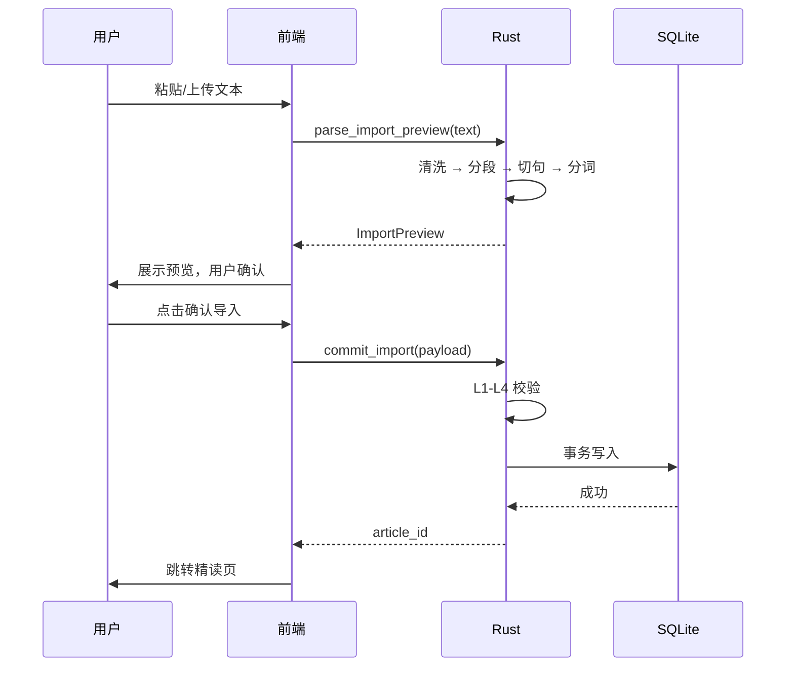

# C4 导入模块设计规格

> 版本：v1.0  
> 状态：定稿  
> 上游文档：`docs/C2-数据模型设计.md`、`docs/C3-Command接口清单.md`  
> 下游文档：`AGENTS.md`、`src-tauri/src/import/`  
> 本文档定义 `parse_import_preview` 与 `commit_import` 的完整规格，包括数据类型、清洗、分段、切句、分词、校验、事务和测试用例。

---

## 1. 文档说明

### 1.1 目的

回答四个问题：

1. **解析怎么做**：文本如何清洗、分段、切句、分词。
2. **数据结构长什么样**：预览和提交的字段与偏移量口径。
3. **提交怎么校验**：四层校验规则与错误码。
4. **怎么入库**：事务顺序、失败回滚、幂等策略。

### 1.2 范围

覆盖用户导入流程的全部前后端逻辑。不覆盖内置文章种子导入（种子格式见 C2 第 7 节，走相同的校验和事务，但入口不同）。

### 1.3 最重要的约束

**偏移量统一 UTF-16 code unit。** 这是前后端能对齐的唯一口径，也是本模块最容易出错的地方。违反此约束的实现视为错误，必须返工。

---

## 2. 模块概述

### 2.1 两阶段设计

| 阶段 | 命令 | 职责 | 写库 |
|---|---|---|---|
| 预览 | `parse_import_preview` | 清洗 → 分段 → 切句 → 分词，返回可渲染结构 | 否 |
| 提交 | `commit_import` | 校验前端确认后的结构，原子入库 | 是 |

### 2.2 关键原则

1. **后端不重复解析**：`commit_import` 不重新切句、不重新分词，只校验和入库。用户在前端调整过的边界必须原样保存。
2. **校验在事务外**：所有校验失败不产生任何数据库操作。
3. **事务原子性**：任何一步失败，article/paragraph/sentence/token 全部回滚。
4. **偏移量由后端生成，前端原样回传**：预览阶段后端算出偏移，前端不在本地重算，commit 时直接复用。
5. **幂等不自动去重**：MVP 重复导入生成新文章，不做自动合并。

### 2.3 数据流



---

## 3. 数据类型定义

### 3.1 偏移量口径

**所有 `start_offset` / `end_offset` 是 UTF-16 code unit 计数。**

- 句子偏移相对**段落文本**。
- token 偏移相对**句子文本**。
- Rust 侧计算长度用 `s.encode_utf16().count()`，**不用 `len()`（字节）或 `chars().count()`（Unicode 标量）**。
- Rust 侧切片必须用辅助函数 `utf16_slice(text, start, end)`，禁止 `&text[a..b]` 直接切。
- 前端 JS 字符串索引天然是 UTF-16，可直接用 `text.slice(start, end)` 渲染，无需转换。

**为什么选 UTF-16**：前端渲染高亮时最直接的索引单位；中英文标点、emoji 在 UTF-8 字节和 Unicode 标量下长度不同，只有 UTF-16 能和 JS 字符串索引一一对应。

### 3.2 `ImportPreview`（预览返回）

```rust
#[derive(Serialize)]
#[serde(rename_all = "camelCase")]
pub struct ImportPreview {
    pub title: Option<String>,          // 从首行 # 标题推断，可为空
    pub cleaned_text: String,           // 清洗后全文，便于前端展示
    pub paragraphs: Vec<PreviewParagraph>,
    pub warnings: Vec<PreviewWarning>,
}

#[derive(Serialize)]
#[serde(rename_all = "camelCase")]
pub struct PreviewParagraph {
    pub idx: usize,
    pub text: String,
    pub sentences: Vec<PreviewSentence>,
}

#[derive(Serialize)]
#[serde(rename_all = "camelCase")]
pub struct PreviewSentence {
    pub idx: usize,
    pub text: String,
    pub start_offset: usize,            // 在段落文本中的 UTF-16 偏移
    pub end_offset: usize,
    pub tokens: Vec<PreviewToken>,
}

#[derive(Serialize)]
#[serde(rename_all = "camelCase")]
pub struct PreviewToken {
    pub idx: usize,
    pub surface: String,
    pub normalized: String,
    pub start_offset: usize,            // 在句子文本中的 UTF-16 偏移
    pub end_offset: usize,
    pub is_word: bool,
}

#[derive(Serialize)]
#[serde(rename_all = "camelCase")]
pub struct PreviewWarning {
    pub paragraph_idx: usize,
    pub sentence_idx: usize,
    pub code: String,                   // 如 "suspected_abbreviation_split"
    pub message: String,
}
```

### 3.3 `ImportCommitPayload`（提交入参）

```rust
#[derive(Deserialize)]
#[serde(rename_all = "camelCase")]
pub struct ImportCommitPayload {
    pub title: String,                  // 必填，trim 后非空
    pub source: Option<String>,
    pub exam_year: Option<i32>,
    pub exam_set: Option<String>,
    pub section_type: Option<String>,   // 默认 "custom"
    pub difficulty: Option<String>,     // easy/medium/hard/custom
    pub paragraphs: Vec<CommitParagraph>,
}

#[derive(Deserialize)]
#[serde(rename_all = "camelCase")]
pub struct CommitParagraph {
    pub idx: usize,
    pub text: String,
    pub sentences: Vec<CommitSentence>,
}

#[derive(Deserialize)]
#[serde(rename_all = "camelCase")]
pub struct CommitSentence {
    pub idx: usize,
    pub text: String,
    pub start_offset: usize,
    pub end_offset: usize,
    pub tokens: Vec<CommitToken>,
}

#[derive(Deserialize)]
#[serde(rename_all = "camelCase")]
pub struct CommitToken {
    pub idx: usize,
    pub surface: String,
    pub normalized: String,
    pub start_offset: usize,
    pub end_offset: usize,
    pub is_word: bool,
}
```

### 3.4 TypeScript 侧对应

```ts
export interface ImportPreview {
  title: string | null;
  cleanedText: string;
  paragraphs: PreviewParagraph[];
  warnings: PreviewWarning[];
}

export interface PreviewParagraph {
  idx: number;
  text: string;
  sentences: PreviewSentence[];
}

export interface PreviewSentence {
  idx: number;
  text: string;
  startOffset: number;
  endOffset: number;
  tokens: PreviewToken[];
}

export interface PreviewToken {
  idx: number;
  surface: string;
  normalized: string;
  startOffset: number;
  endOffset: number;
  isWord: boolean;
}

export interface ImportCommitPayload {
  title: string;
  source?: string | null;
  examYear?: number | null;
  examSet?: string | null;
  sectionType?: string | null;
  difficulty?: string | null;
  paragraphs: CommitParagraph[];
}

// CommitParagraph / CommitSentence / CommitToken 同结构，字段名 camelCase
```

**提交时前端必须原样复用预览返回的偏移量**，不在前端重新计算。用户调整句子边界时，前端只改 `sentences` 数组的 `text` 和 `startOffset/endOffset`（P1 能力），不重算 token 偏移——若用户调整了句子边界，MVP 建议提示“调整后请重新预览”，避免 token 偏移错位。

---

## 4. 文本清洗规则

输入是用户粘贴或上传的 `.txt/.md` 原始文本。清洗按顺序执行，**容错优先，不抛错**。

| 步骤 | 操作 | 说明 |
|---|---|---|
| 1 | 统一换行 | `\r\n`、`\r` → `\n` |
| 2 | 去 BOM | 去掉文件头 `\u{FEFF}` |
| 3 | 去零宽字符 | 删除 `\u{200B}`、`\u{200C}`、`\u{200D}`、`\u{FEFF}` |
| 4 | 全角转半角（仅标点和数字） | `，。！？；：（）` → `,.!?;:()`，全角数字转半角 |
| 5 | 压缩行内空白 | 行内连续空格/Tab 压成一个空格；保留段落间空行 |
| 6 | 去行首尾空白 | 每行 `trim` |
| 7 | 提取标题 | 首行匹配 `^#\s+(.+)$` 则提取为 `title`，并从正文移除 |
| 8 | 剔除题目区 | 识别 `## 题目`、`## 答案` 及之后内容，MVP 直接剔除，只精读正文 |

**注意**：
- 第 4 步**不要转换中文汉字**，只转标点和数字，避免误伤。
- 第 8 步是 MVP 的简化：用户若粘贴了带题目的材料，只精读正文部分。题目录入能力 P1 再做。
- 清洗失败不抛错；只有清洗后正文为空时返回 `empty_article`。

---

## 5. 分段规则

1. 以**一个或多个连续空行**作为段落分隔。
2. 每个非空块 `trim` 后作为一个 `paragraph.text`。
3. 连续空行合并，不产生空段落。
4. **全文无空行时**：作为单个段落，并在 `warnings` 中追加 `no_blank_line`：“未检测到空行，已作为单段处理”。

**不做自动分段兜底**。自动按句数切段会引入不可预期的边界，用户预览时可以自己判断是否需要返回修改文本。

---

## 6. 切句规则

切句在**每个段落内**独立进行，不跨段。目标是覆盖四级阅读常见文本，**宁可少切，不要错切**。

### 6.1 基本终止符

句子在以下字符后结束：`.`、`!`、`?`。

- 连续终止符视为整体：`...`、`?!`、`!!`、`?!?`，只在最后一个终止符后切。
- 终止符后紧跟闭合引号或括号（`"`、`'`、`)`、`]`），把终止符和闭合符一起作为句尾。

### 6.2 必须排除的“伪终止”场景

| 场景 | 规则 | 示例 |
|---|---|---|
| 缩写词 | 终止符前一个 token（小写）在缩写表中，且后跟空格+大写字母或数字，不切 | `Mr. Smith`、`Dr. Lee` |
| 多点缩写 | `e.g.`、`i.e.`、`a.m.`、`p.m.`、`U.S.`、`U.K.` 整体识别，不切 | `e.g. this` |
| 小数 | 终止符前后都是数字，不切 | `3.14`、`v1.2` |
| 单字母缩写 | 终止符前是单个大写字母，且后跟空格+大写字母或另一单字母缩写，不切 | `J. K. Rowling` |
| 引号内未闭合 | 终止符在引号内且引号未闭合，不切；等闭合后再切 | `He said, "Hello.`（未闭合） |
| 省略号后小写 | `...` 后跟空格+小写字母，不切，加 warning | `Don't stop... keep going.` |
| 终止符后无空格且下一字符小写 | 不切，加 warning | 异常文本 |
| 终止符后是逗号/分号 | 不切 | `.;` |

### 6.3 缩写表（常量）

```rust
const ABBREVIATIONS: &[&str] = &[
    "mr", "mrs", "ms", "dr", "prof", "st", "jr", "sr", "vs", "etc",
    "e.g", "i.e", "a.m", "p.m", "u.s", "u.k", "u.n", "no", "fig",
    "inc", "ltd", "co", "corp", "dept", "est", "approx",
];
```

比对时取终止符前 token 的小写形式，去尾部点后匹配。多点缩写（如 `e.g.`）在切句前先用最长匹配识别。

### 6.4 段落末尾

段落最后一个字符无论是否是终止符，都作为一句结束。

### 6.5 输出

每个句子记录：`idx`（段内从 0 开始）、`text`（含句尾标点，不含首尾空白）、`start_offset`、`end_offset`（相对段落文本的 UTF-16 偏移）。句子之间的空白不归属任何句子。

### 6.6 兜底

一段切出来只有 1 句且长度超过 200 字符时，追加 warning `long_sentence`：“疑似切句失败，请检查”，但不强制再切。

---

## 7. 分词规则

分词在**每个句子内**独立进行。目标是让前端能精确点击，不是做语言学级分词。

### 7.1 基本规则

| 字符类别 | 处理 |
|---|---|
| 空白（空格、Tab、换行） | 分隔符，不生成 token |
| 标点 | 单独成 token，`is_word=false`；连续标点合并为一个 token |
| 字母、数字 | 连续字母数字组成词 token |
| 撇号 `'` | 保留在词内（`don't`、`it's`） |
| 连字符 `-` | 保留在词内（`well-known`、`state-of-the-art`） |
| 首尾撇号 | 视为标点，剥离为独立 token |

**标点集合**：`, . ! ? ; : " ' ( ) [ ] { } — – - / \ @ # $ % ^ & * + = | ~ \` < >`

### 7.2 `normalized` 规则

1. 转小写。
2. 去首尾非字母数字字符，**保留词内撇号和连字符**。
3. **不做词形还原**。`lemma` 字段 MVP 留空；`running` 和 `run` 在生词本中按不同条目处理，这是 MVP 接受的取舍。

### 7.3 数字

- `2025`、`3.14`、`1,000` 作为单个 token，`is_word=true`（可点击，但不一定进生词本）。
- 数字与字母混合（`COVID-19`、`4G`）作为一个 token。

### 7.4 覆盖校验

分词完成后，在 Rust 侧做一次校验：**句子中所有未被 token 覆盖的片段，只允许空白或标点字符**。若含字母或数字，返回 `token_coverage_invalid`。

---

## 8. `commit_import` 四层校验

校验顺序：**L1 结构 → L2 偏移 → L3 覆盖 → L4 业务**。任何一层失败立即返回，不进入下一层，不产生数据库操作。

### 8.1 L1 结构校验

| 规则 | 错误码 |
|---|---|
| `title.trim()` 非空 | `missing_title` |
| `paragraphs` 非空，且至少一个段落 `text.trim()` 非空 | `empty_article` |
| `paragraphs[i].idx == i` | `paragraph_index_invalid` |
| `sentences[j].idx == j` | `sentence_index_invalid` |
| `tokens[k].idx == k` | `token_index_invalid` |
| 每个 `start_offset < end_offset` | `offset_out_of_range` |
| 强制 `visibility = 'user'`，忽略前端传入 | — |

### 8.2 L2 偏移校验（UTF-16 口径）

| 规则 | 错误码 |
|---|---|
| 句子 `end_offset <= paragraph.text.encode_utf16().count()` | `offset_out_of_range` |
| token `end_offset <= sentence.text.encode_utf16().count()` | `offset_out_of_range` |
| 同层子项按 `start_offset` 排序后，`current.start >= prev.end` | `offset_order_invalid` |

**Rust 实现必须用 `encode_utf16().count()`，禁止 `len()` 或 `chars().count()`。**

### 8.3 L3 覆盖校验

**句子覆盖段落：**

1. 句子按 `start_offset` 排序。
2. 维护 `cursor = 0`。
3. 对每个句子：检查 `paragraph.text` 在 `[cursor, sentence.start_offset)` 区间的 gap，**只允许空白字符**。含非空白字符返回 `sentence_coverage_invalid`，`path` 指向该句子。
4. `cursor = sentence.end_offset`。
5. 最后检查 `[cursor, 段落长度)` 也只含空白。

**Token 覆盖句子：**

1. token 按 `start_offset` 排序。
2. 维护 `cursor = 0`。
3. 对每个 token：检查句子文本在 `[cursor, token.start_offset)` 区间的 gap，**只允许空白或标点字符**。含字母/数字返回 `token_coverage_invalid`。
4. 检查 `utf16_slice(sentence.text, token.start_offset, token.end_offset) == token.surface`，不相等返回 `text_mismatch`。
5. `cursor = token.end_offset`。
6. 最后检查 `[cursor, 句子长度)` 只含空白或标点。

**`utf16_slice` 辅助函数**：把 UTF-16 偏移转成字节偏移后切片，必须处理代理对边界。实现示例：

```rust
fn utf16_slice(text: &str, start: usize, end: usize) -> Option<String> {
    if start >= end { return Some(String::new()); }
    let mut utf16_pos = 0usize;
    let mut byte_start: Option<usize> = None;
    let mut byte_end: Option<usize> = None;
    for (byte_idx, ch) in text.char_indices() {
        if utf16_pos == start { byte_start = Some(byte_idx); }
        utf16_pos += ch.len_utf16();
        if utf16_pos == end { byte_end = Some(byte_idx + ch.len_utf8()); break; }
    }
    match (byte_start, byte_end) {
        (Some(s), Some(e)) => Some(text[s..e].to_string()),
        _ => None,
    }
}
```

### 8.4 L4 业务校验

| 规则 | 处理 |
|---|---|
| `difficulty` 若提供，必须是 `easy/medium/hard/custom` | 非法值归一为 `custom` |
| `exam_year` 若提供，范围 1987—2100 | 非法值忽略 |
| `section_type` 为空 | 默认 `"custom"` |
| `word_count` | 由后端统计 `is_word=true` 的 token 数，**不信任前端** |

### 8.5 错误结构

```rust
#[derive(Serialize)]
#[serde(rename_all = "camelCase")]
pub struct CommitError {
    pub code: String,
    pub message: String,
    pub path: Option<String>,   // 如 "paragraphs[2].sentences[5].tokens[3]"
}
```

`path` 用于前端定位并高亮对应段落/句子/token，而不是只弹 toast。

---

## 9. 事务入库

### 9.1 流程

```rust
#[tauri::command]
pub fn commit_import(
    state: tauri::State<'_, std::sync::Mutex<rusqlite::Connection>>,
    payload: ImportCommitPayload,
) -> Result<i64, CommitError> {
    validate(&payload)?;  // L1-L4 全部在事务外

    let mut conn = state.lock().map_err(|_| CommitError::db("lock failed"))?;
    let tx = conn.transaction().map_err(CommitError::db)?;

    let article_id = insert_article(&tx, &payload)?;
    for p in &payload.paragraphs {
        let paragraph_id = insert_paragraph(&tx, article_id, p)?;
        for s in &p.sentences {
            let sentence_id = insert_sentence(&tx, article_id, paragraph_id, s)?;
            insert_tokens(&tx, sentence_id, &s.tokens)?;
        }
    }

    tx.commit().map_err(CommitError::db)?;
    Ok(article_id)
}
```

### 9.2 各表插入规则

**article**：

```sql
INSERT INTO article
  (source_key, title, source, exam_year, exam_set, section_type, difficulty,
   word_count, visibility, status, created_at, updated_at)
VALUES
  (?1, ?2, ?3, ?4, ?5, ?6, ?7, ?8, 'user', 'published',
   datetime('now'), datetime('now'));
```

- `source_key = format!("user-{}", uuid::Uuid::new_v4())`。
- `word_count` 在入库前统计：所有 `is_word=true` 的 token 数。

**paragraph**：

```sql
INSERT INTO paragraph (article_id, idx, text) VALUES (?1, ?2, ?3);
```

`paragraph_id = tx.last_insert_rowid()`。

**sentence**：

```sql
INSERT INTO sentence
  (article_id, paragraph_id, idx, text, text_hash, start_offset, end_offset)
VALUES (?1, ?2, ?3, ?4, ?5, ?6, ?7);
```

- `text_hash`：`sentence.text` 的 SHA-256 前 16 位十六进制（`sha2` crate）。
- `article_id` 冗余存储，便于查询。

**token**：

```sql
INSERT INTO token
  (sentence_id, idx, surface, normalized, lemma, start_offset, end_offset, pos)
VALUES (?1, ?2, ?3, ?4, NULL, ?5, ?6, NULL);
```

`lemma` 和 `pos` MVP 留空。

### 9.3 批量插入

token 数量可能上百到上千，**不要每次 `tx.execute` 都重新 prepare**。在循环外 prepare：

```rust
fn insert_tokens(tx: &rusqlite::Transaction, sentence_id: i64, tokens: &[CommitToken]) -> Result<(), CommitError> {
    let mut stmt = tx.prepare(
        "INSERT INTO token (sentence_id, idx, surface, normalized, lemma, start_offset, end_offset, pos)
         VALUES (?1, ?2, ?3, ?4, NULL, ?5, ?6, NULL)"
    ).map_err(CommitError::db)?;
    for (k, t) in tokens.iter().enumerate() {
        stmt.execute(rusqlite::params![
            sentence_id, k as i64, t.surface, t.normalized,
            t.start_offset as i64, t.end_offset as i64
        ]).map_err(CommitError::db)?;
    }
    drop(stmt);  // 必须在返回前 drop，否则借用检查阻止 commit
    Ok(())
}
```

**`stmt` 必须在 `tx.commit()` 前 `drop`**，否则 Rust 借用检查会阻止 commit。

### 9.4 失败回滚

任何一步 `?` 提前返回，`tx` 被 drop，自动 rollback。前端收到的 `CommitError` 带 `code` 和 `path`，可定位具体位置。

---

## 10. 幂等与重复导入

**MVP 不做自动去重。** 用户每次点击“导入”都生成新文章，新的 `source_key`（UUID）和 `article_id`。

**理由**：用户可能导入同一篇的不同版本（修订、不同来源），自动合并容易丢笔记或错位。强行去重需要“按标题+正文 hash 匹配”，匹配失败和误匹配的代价都高于重复导入。

**P1 可加提示**：`parse_import_preview` 返回中增加 `similar_articles: Vec<ArticleSummary>`，若找到标题相同且首段 hash 相同的文章，前端弹窗提示“检测到相似文章，仍要导入吗？”，用户确认后照常 commit。

**系统文章不受影响**：`visibility='system'` 的文章由种子导入，用户导入永远创建 `visibility='user'` 的新记录。

---

## 11. 错误码汇总

| code | 触发条件 | 前端处理 |
|---|---|---|
| `empty_article` | 清洗后正文为空，或 `paragraphs` 为空 | 提示“正文不能为空” |
| `missing_title` | `title.trim()` 为空 | 定位标题输入框 |
| `text_too_long` | 输入超过 100KB | 提示拆分导入 |
| `parse_error` | 解析过程异常 | 提示“解析失败，请调整文本” |
| `paragraph_index_invalid` | 段落 idx 不连续 | 定位段落 |
| `sentence_index_invalid` | 句子 idx 不连续 | 定位句子 |
| `token_index_invalid` | token idx 不连续 | 定位 token |
| `offset_out_of_range` | `start >= end` 或越界 | 提示解析异常 |
| `offset_order_invalid` | 偏移重叠或乱序 | 提示解析异常 |
| `sentence_coverage_invalid` | 段落中有字母未被句子覆盖 | 定位句子 |
| `token_coverage_invalid` | 句子中有字母未被 token 覆盖 | 定位 token |
| `text_mismatch` | `surface` 与 `utf16_slice` 结果不一致 | 提示解析异常 |
| `db_error` | 数据库写入失败 | 提示“保存失败，请重试”，不暴露 SQL |

---

## 12. 测试用例

测试放 `src-tauri/src/import/parse_tests.rs` 和 `commit_tests.rs`。commit 测试用 `Connection::open_in_memory()` + 执行 `001_init.sql`。

### 12.1 解析测试（parse）

| 用例 | 输入 | 期望 |
|---|---|---|
| 缩写不切 | `Mr. Smith went to the U.S. last year.` | 1 句，`U.S.` 不切 |
| 小数不切 | `It costs $3.14, not $3.15.` | 1 句 |
| 引号闭合后切 | `He said, "Hello." Then he left.` | 2 句 |
| 省略号后小写不切 | `Don't stop... keep going.` | 1 句，有 warning |
| 单字母缩写不切 | `J. K. Rowling writes.` | 1 句 |
| 连字符不拆词 | `well-known authors` | `well-known` 是单 token |
| 撇号保留 | `don't` | `surface="don't"`，`normalized="don't"` |
| 无空行 | 连续文本 | 单段 + `no_blank_line` warning |
| 全角标点 | `你好，世界！` | 清洗后正常切句 |
| 中文偏移 | 段落含中文 | 句子/token 偏移按 UTF-16 正确 |
| emoji 偏移 | 段落含 emoji | 偏移不越界，`utf16_slice` 返回正确 |
| 空文本 | `""` | `empty_article` |
| 超长文本 | 101KB | `text_too_long` |

### 12.2 提交测试（commit）

| 用例 | 构造 | 期望 |
|---|---|---|
| 正常导入 | 2 段，每段 2 句，偏移正确 | 返回 `article_id > 0`，四表数量正确 |
| 空段落 | `paragraphs = []` | `empty_article` |
| 标题为空 | `title = "  "` | `missing_title` |
| 段落 idx 不连续 | `[0, 2]` | `paragraph_index_invalid` |
| 句子 idx 不连续 | `[0, 2]` | `sentence_index_invalid` |
| token idx 不连续 | `[0, 2]` | `token_index_invalid` |
| 句子偏移越界 | `end > 段落 UTF-16 长度` | `offset_out_of_range` |
| 句子重叠 | 两句 start 重叠 | `offset_order_invalid` |
| 句子未覆盖 | 段落中间有字母未被覆盖 | `sentence_coverage_invalid` |
| token 重叠 | 两个 token 偏移重叠 | `offset_order_invalid` |
| token 未覆盖 | 句子中有字母未被 token 覆盖 | `token_coverage_invalid` |
| surface 不匹配 | `surface="hello"`，文本为 `"world"` | `text_mismatch` |
| 中文+emoji 偏移 | 段落含中文和 emoji | 导入成功，`utf16_slice` 正确 |
| 事务回滚 | 模拟 token 插入失败 | `db_error`，article 表无残留 |
| 重复导入 | 同一 payload 调两次 | 两个不同 `article_id`，`source_key` 不同 |
| 强制 user | payload 传 `visibility=system`（若字段存在） | 忽略，写入 `user` |

**事务回滚测试**是重点：可用测试专用 schema（给 token 表加 `CHECK(length(surface) < 5)`）触发中途失败，确认 article 表无残留。

### 12.3 `utf16_slice` 测试

| 用例 | 期望 |
|---|---|
| ASCII 区间 | 返回正确子串 |
| 中文区间 | 返回正确子串 |
| emoji（代理对）区间 | 不 panic，返回正确或 `None` |
| 边界：start=0 | 从开头切 |
| 边界：end=长度 | 切到末尾 |
| 非法区间：start>end | 返回空串或 `None` |
| 超出长度 | 返回 `None` |

---

## 13. 前端交互约定

### 13.1 预览页

1. 用户粘贴/上传后，点击“预览”。
2. 展示：
   - 提取的标题（可编辑）。
   - 分段结果，每段按句子显示，句子之间有视觉分隔。
   - `warnings` 以黄色提示条展示。
   - 显示“确认导入”和“返回修改”。
3. **MVP 预览只读**，不提供句子边界编辑。用户若觉得切句不对，返回修改原文重新预览。
4. P1 可加“合并/拆分句子”能力，但调整后必须重新预览，不直接改偏移。

### 13.2 提交

1. 点击“确认导入”，按钮进入 loading，禁用重复提交。
2. 前端组装 `ImportCommitPayload`，**偏移量直接复用预览返回的值**。
3. 成功：清空预览状态，跳转精读页，toast “导入成功”。
4. 失败：
   - 若 `path` 存在，高亮对应位置。
   - `db_error` 展示“保存失败，请重试”，不暴露 SQL。
   - 保留预览状态，允许用户重试。

### 13.3 导入后

1. 文章出现在“我的导入”，`visibility='user'`，可删除。
2. 删除时 `ON DELETE CASCADE` 清理结构、笔记、复习计划、阅读记录。
3. 生词的来源引用置 NULL，生词保留。

---

## 14. 给 AI 的提示词模板

写进 `AGENTS.md` 或每次实现时附带：

> 实现 `src-tauri/src/import/` 下的解析与提交。严格遵守 C4 规格：偏移量一律 **UTF-16 code unit**，Rust 侧用 `encode_utf16().count()`，切片用 `utf16_slice` 辅助函数，禁止字节索引。切句使用缩写表常量，不引入 NLP crate。分词手写遍历，标点单独成 token 且 `is_word=false`，撇号和连字符保留在词内。`normalized` 只做小写和去首尾非字母数字，不做词形还原。`parse_import_preview` 不写库；`commit_import` 先做 L1—L4 校验（事务外），再开事务按 article → paragraph → sentence → token 插入，token 用循环外 prepare 的 statement，`stmt` 在 commit 前 drop。`source_key` 用 UUID，`word_count` 由后端统计。错误返回 `CommitError { code, message, path }`。为第 12 节测试用例写单元测试。不要修改 schema，不要重新切句，不要引入新依赖。

---

## 15. 与其它文档的关系

- **C2 第 4 节**：`article/paragraph/sentence/token` 表结构，本文件是其写入规则。
- **C3 5.2 节**：`parse_import_preview` 与 `commit_import` 的接口签名，本文件是其实现规格。
- **C1 第 9 节**：UTF-16 偏移约束的总体说明。
- **D3 测试计划**：第 12 节测试用例的来源。
- **AGENTS.md**：本文件的硬约束是 AI 编码必须遵守的规则。
- **A2 F5**：导入功能的用户视角规则，本文件是其技术实现。

---

*本文档随导入功能演进更新。偏移量口径、四层校验、事务顺序是硬约束，变更需在 F3 决策记录中留痕。*
